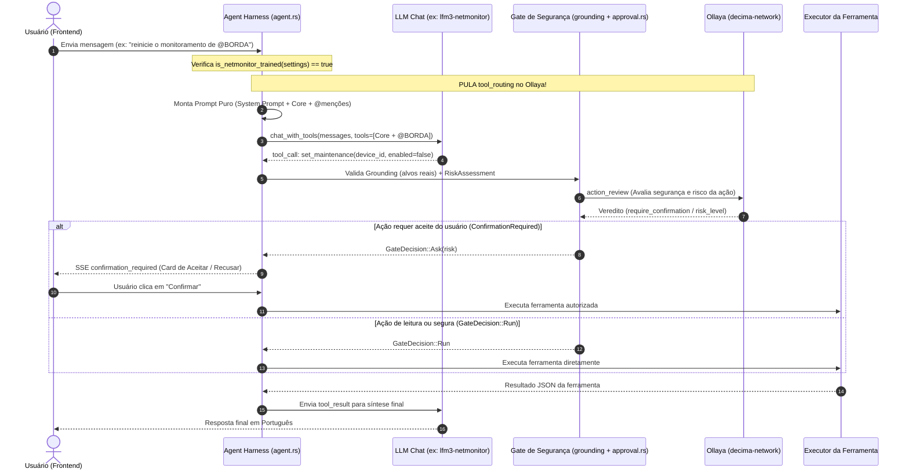

# Especificação: Modelos Treinados para o NetMonitor e Bypass do Roteamento de Ferramentas (Ollaya)

## 1. Objetivo e Motivação

O NetMonitor possui hoje dois papéis distintos para a camada de decisão local (**Ollaya / `decima-network`**) durante o funcionamento do Assistente de IA (`agent.rs`):

1. **Roteamento de Ferramentas (`tool_routing`)**: antes da primeira chamada ao LLM do chat, o Ollaya lê a pergunta do usuário e pré-seleciona quais `ToolGroup`s (ex.: `Diagnostics`, `Snmp`, `Infrastructure`, `ExternalSearch`) devem ter seus JSON Schemas injetados no payload de `tools` enviado ao LLM.
2. **Revisão de Segurança e Aprovação de Ações (`action_review`)**: quando o LLM decide executar uma ferramenta com efeito colateral ou risco (ex.: `set_maintenance`, `acknowledge_incident`, `run_playbook`, `scan_ports`, `create_backup`), o `ActionReviewer` (`approval::decide`) avalia o risco e consulta o Ollaya (`action_review`) para decidir se a ação pode prosseguir automaticamente (`GateDecision::Run`) ou se deve pausar o turno e exigir confirmação explícita do usuário na interface (`GateDecision::Ask` → `ConfirmationRequired`).

### O Problema Atual

Quando o usuário utiliza um modelo **pós-treinado especificamente com as ferramentas do NetMonitor** (como a família `lfm3-netmonitor:latest`, `lfm3-netmonitor:q5_k_m` e `lfm3-netmonitor:q4_k_m`, ou outro modelo ajustado pelo próprio usuário):

1. **Redundância no `tool_routing`**: o modelo de chat já conhece nativamente todas as ferramentas do NetMonitor e o catálogo compacto `FERRAMENTAS SOB DEMANDA` presente no system prompt (~250 tokens), sabendo acionar `load_tools` ou invocar a ferramenta diretamente. Consultar o Ollaya antes do chat adiciona uma rodada extra de rede/inferência desnecessária.
2. **Fallback atual inflado quando `routed == None`**: hoje, em `backend/src/services/ai/harness/agent.rs`, quando o `consult_decider` retorna `None` no modo `ToolLoading::OnDemand`, o fallback `(ToolLoading::OnDemand, None) => everything()` injeta **todas as 61 ferramentas (~10.300 tokens)** na primeira chamada ao LLM, desperdiçando janela de contexto e aumentando o *Time-To-First-Token* (TTFT) na CPU.
3. **Acoplamento indevido entre Roteamento e Segurança**: desativar o Decisor inteiro para evitar o `tool_routing` desativaria também o `action_review` (segurança/aprovação de comandos) e as tarefas autônomas de background (`device_identity`, `interfaces`, `log_events`, `incident_triage`).

### A Solução Proposta

Adicionar a propriedade **`netmonitor_trained`** (indicando que o modelo de chat foi treinado com as ferramentas do NetMonitor):
- **Quando `netmonitor_trained == true`**:
  - O orquestrador **não consulta o Ollaya para `tool_routing`** antes do prompt de chat.
  - É enviado **somente o prompt puro/enxuto** (~2.970 tokens): system prompt com a lista `FERRAMENTAS SOB DEMANDA` + ferramentas `ToolGroup::Core` (`get_network_summary`, `find_device`, `list_incidents`, `load_tools`, `ask_user`) + grupos derivados de menções explícitas `@` (`context_groups`).
  - O modelo treinado carrega grupos adicionais sob demanda via `load_tools` ou chama a ferramenta diretamente pelo nome (já suportado em `handle_tool_call`).
- **O Ollaya permanece 100% ativo para Segurança (`action_review`)**:
  - Todas as travas determinísticas (`grounding::invented_target`, `RiskAssessment`, `AiAutomationMode`) e a revisão semântica do Ollaya (`ActionReviewer` / `approval::decide`) continuam interceptando cada chamada de ferramenta antes da execução, garantindo que ações sensíveis peçam confirmação do usuário (`ConfirmationRequired`) ou sejam bloqueadas se inseguras.

---

## 2. Fluxo Arquitetural



---

## 3. Especificação Técnica (Backend — Rust)

### 3.1. Catálogo de Modelos (`backend/src/services/ai/ollama.rs`)

1. Adicionar o campo `netmonitor_trained: bool` na struct `OllamaRecommendedModel`:

```rust
#[derive(Debug, Clone, Serialize)]
pub struct OllamaRecommendedModel {
    pub name: &'static str,
    pub label: &'static str,
    pub parameter_size: &'static str,
    pub quant_level: &'static str,
    pub estimated_ram_gb: f32,
    pub min_system_ram_gb: u32,
    pub summary: &'static str,
    pub recommended_for: &'static str,
    pub supports_tools: bool,
    pub bundled: bool,
    /// Indica se o modelo passou por fine-tuning com as ferramentas do NetMonitor,
    /// dispensando o `tool_routing` do Ollaya e recebendo apenas o prompt enxuto.
    pub netmonitor_trained: bool,
}
```

2. Marcar `netmonitor_trained: true` nos modelos da família `lfm3-netmonitor` (`lfm3-netmonitor:latest`, `lfm3-netmonitor:q5_k_m`, `lfm3-netmonitor:q4_k_m`) e `false` nos modelos genéricos (`qwen2.5`, `llama3.1`, `mistral`, etc.).
3. Criar função auxiliar pública em `ollama.rs`:

```rust
/// Retorna `true` se o nome do modelo corresponde a um modelo nativo treinado
/// com o catálogo de ferramentas do NetMonitor (ex.: `lfm3-netmonitor:*`).
pub fn is_known_netmonitor_trained(model: &str) -> bool {
    let trimmed = model.trim().to_ascii_lowercase();
    trimmed == "lfm3-netmonitor"
        || trimmed.starts_with("lfm3-netmonitor:")
        || RECOMMENDED_MODELS
            .iter()
            .any(|m| m.netmonitor_trained && m.name.eq_ignore_ascii_case(trimmed.as_str()))
}
```

### 3.2. Configurações de IA (`backend/src/services/ai/settings.rs` e banco SQLite)

Para permitir que o usuário **visualize** essa opção no modelo selecionado e também possa **ativá-la ou desativá-la manualmente** (por exemplo, ao testar um modelo customizado no Ollama ou LM Studio que foi treinado para o NetMonitor):

1. Adicionar em `AiSettings` (`settings.rs`):

```rust
#[derive(Debug, Clone, Serialize, Deserialize)]
pub struct AiSettings {
    // ... campos existentes ...
    /// Quando `Some(true)`, informa que o modelo ativo foi treinado com as
    /// ferramentas do NetMonitor (pula o `tool_routing` do Ollaya e envia o prompt puro).
    /// Quando `None`, o backend infere automaticamente pelo nome do modelo (`is_known_netmonitor_trained`).
    #[serde(default)]
    pub netmonitor_trained_model: Option<bool>,
}
```

2. Adicionar método resolvedor em `AiSettings`:

```rust
impl AiSettings {
    /// Determina se o modelo configurado atualmente é treinado com as ferramentas do NetMonitor.
    pub fn is_netmonitor_trained(&self) -> bool {
        if let Some(explicit) = self.netmonitor_trained_model {
            return explicit;
        }
        if self.provider == AiProviderKind::Ollama {
            return crate::services::ai::ollama::is_known_netmonitor_trained(self.active_model());
        }
        false
    }
}
```

3. Persistir a chave `ai_netmonitor_trained_model` (`"auto"` / `"true"` / `"false"`) na tabela `settings` do SQLite (seguindo o mesmo padrão de `ai_automation_mode` em `settings.rs`).

### 3.3. Orquestrador do Agente (`backend/src/services/ai/harness/agent.rs`)

No método `run_loop` de `agent.rs`, ajustar a seleção inicial de grupos de ferramentas (`preselected`) para que modelos treinados no NetMonitor **não chamem `consult_decider`** e recebam apenas `Core` + `context_groups`:

```rust
let context_preselected = context_groups(
    &request.context.mentions,
    request.context.focused_device_id.is_some(),
);

let netmonitor_trained = settings.is_netmonitor_trained();

let routed = if !netmonitor_trained && matches!(tool_loading, ToolLoading::OnDemand) {
    consult_decider(&ctx, &settings, &request, &registry, &context_preselected).await
} else {
    None
};

let preselected: ToolGroups = match (tool_loading, netmonitor_trained, routed) {
    (ToolLoading::Full, _, _) => everything(),
    // Modelo treinado para o NetMonitor: envia apenas o prompt puro (Core + menções @),
    // sem consultar o Ollaya para tool_routing e sem despejar as 61 ferramentas.
    (ToolLoading::OnDemand, true, _) => context_preselected,
    // Modelo genérico com roteamento do Ollaya ativo:
    (ToolLoading::OnDemand, false, Some(mut decider_groups)) => {
        decider_groups.extend(context_preselected);
        decider_groups
    }
    // Modelo genérico sem Ollaya disponível: fallback com catálogo completo.
    (ToolLoading::OnDemand, false, None) => everything(),
};
```

> [!IMPORTANT]
> **Segurança preservada (`ActionReviewer`):**
> Observe que `session.reviewer` (`ActionReviewer::new(&ctx, &settings)`) e a chamada `approval::decide(&tool, &args, settings.automation_mode, session.reviewer.as_ref()).await` dentro de `handle_tool_call` **não sofrem nenhuma alteração**.
> Assim, sempre que o modelo tentar executar uma ação de manutenção, alteração de estado, scan ativo ou playbook, o Ollaya (`action_review`) e as regras de `RiskAssessment` continuarão validando a segurança e emitindo `ConfirmationRequired` para o usuário aceitar ou recusar o comando no chat.

---

## 4. Especificação Técnica (Frontend — Vue 3 + TypeScript)

### 4.1. Tipos e Catálogo (`frontend/src/data/aiModelCatalog.ts` e `frontend/src/stores/aiChat.ts`)

1. Adicionar `netmonitor_trained?: boolean` na interface `OllamaRecommendedModel` (`aiModelCatalog.ts`) e `netmonitor_trained_model?: boolean | null` em `AiSettings` (`aiChat.ts`).

### 4.2. Configuração do Modelo (`frontend/src/components/settings/ai/OllamaProviderFields.vue` e `AiModelChips.vue`)

1. **Badge visual nos cards do modelo (`AiModelChips.vue` / `OllamaProviderFields.vue`)**:
   - Exibir uma tag/badge destacada nos modelos com `netmonitor_trained: true`:
     `Treinado p/ NetMonitor • Prompt Puro`
2. **Opção configurável na tela de Configurações de IA**:
   - Abaixo da seleção de modelo (em `OllamaProviderFields.vue` ou `AiProviderSection.vue`), exibir um toggle/switch:
     - **Título**: *"Modelo treinado com as ferramentas do NetMonitor"*
     - **Descrição**: *"Envia o prompt enxuto diretamente ao modelo sem passar pelo roteamento de ferramentas do Ollaya. O Ollaya permanece ativo verificando a segurança dos comandos e solicitando confirmação do usuário quando necessário."*
   - Quando o usuário seleciona na lista um modelo `lfm3-netmonitor:*`, o toggle já vem ativado automaticamente; caso selecione um modelo customizado que ele mesmo treinou, pode ativar a opção manualmente.

---

## 5. Resumo do Comportamento por Cenário

| Cenário | Passa pelo Ollaya no `tool_routing`? | Prompt enviado ao LLM de Chat | Passa pelo Ollaya no `action_review` (Segurança / Confirmação do Usuário)? |
| :--- | :---: | :--- | :---: |
| **`lfm3-netmonitor:*`** (`netmonitor_trained = true`) | **Não** (Bypass direto) | **Prompt Puro/Enxuto** (~2.970 tokens: System + `Core` + `@menções`) | **Sim** (Verifica segurança e pede aceite em `ConfirmationRequired`) |
| **Modelo customizado c/ opção marcada** (`netmonitor_trained = true`) | **Não** (Bypass direto) | **Prompt Puro/Enxuto** (~2.970 tokens: System + `Core` + `@menções`) | **Sim** (Verifica segurança e pede aceite em `ConfirmationRequired`) |
| **Modelo genérico Ollama (`qwen2.5`, `llama3.1`) c/ Ollaya ativo** (`netmonitor_trained = false`) | **Sim** (`tool_routing` pré-seleciona grupos) | **Prompt Roteado** (System + `Core` + grupos escolhidos pelo Ollaya) | **Sim** (Verifica segurança e pede aceite em `ConfirmationRequired`) |
| **Modelo genérico s/ Ollaya** (`netmonitor_trained = false`) | **Não** | **Prompt Completo** (~10.300 tokens: todas as 61 ferramentas) | **Apenas Gate Determinístico** (`RiskAssessment` + `grounding`) |

---

## 6. Plano de Testes Recomendado para a Implementação

1. **Testes Unitários em `ollama.rs` e `settings.rs`**:
   - Verificar que `is_known_netmonitor_trained("lfm3-netmonitor:latest")`, `"lfm3-netmonitor:q5_k_m"` e `"lfm3-netmonitor:q4_k_m"` retornam `true`, enquanto `"qwen2.5:7b"` retorna `false`.
   - Verificar que `settings.is_netmonitor_trained()` respeita a sobrescrita manual `Some(true)` / `Some(false)` e usa a detecção automática quando `None`.
2. **Testes de Integração no `agent.rs`**:
   - `netmonitor_trained_skips_tool_routing_and_sends_lean_prompt`: garantir que com `netmonitor_trained = true`, o mock do Ollaya **não recebe** chamada na tarefa `tool_routing` e a primeira chamada ao provedor LLM contém apenas as ferramentas do grupo `Core` (mais eventuais `@menções`).
   - `netmonitor_trained_still_enforces_action_review_and_user_confirmation`: garantir que quando o modelo `netmonitor_trained = true` chama uma ferramenta sensível (ex.: `set_maintenance` ou `run_playbook`), o `ActionReviewer` (Ollaya `action_review` + `RiskAssessment`) continua sendo executado e retorna `ConfirmationRequired` para aceite do usuário.

