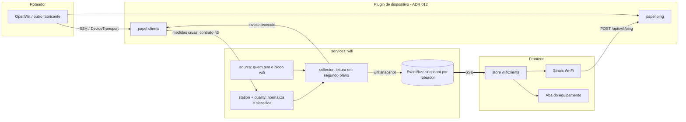

# Monitoramento de Sinais e Clientes Wi-Fi

> **Status:** 🟢 Fases 1–4 e aparelhos vigiados com alertas concluídos (OpenWrt). Fase 5 (outros
> fabricantes) aberta — ver §9.
> **Backend:** `backend/src/services/wifi/` · **Frontend:** `frontend/src/components/wifi/`,
> `frontend/src/pages/WifiClientsPage.vue` · **Tempo real:** só SSE (`wifi:snapshot`,
> `wifi:watched`).

---

## 1. O que resolve

Mostra **quem está conectado** em cada roteador e **como está a conexão** de cada aparelho —
sinal, ruído, retransmissão, velocidade e latência —, para achar sem esforço o cliente longe
demais, a rede com interferência e o aparelho que só parece ruim porque está dormindo.

| Onde | O que o operador faz |
|---|---|
| **Sinais Wi-Fi** (`/wifi`, menu Rede) | Vê os clientes de todos os roteadores juntos, de quem precisa de atenção para quem está bem; filtra em um clique por "Precisam de atenção", "Em repouso", roteador, banda ou busca; vê qual roteador falhou na leitura. |
| **Equipamento** (`/devices/{id}`, aba **Clientes Wi-Fi**) | Os clientes daquele roteador, com os mesmos filtros e o teste de latência. A aba só existe quando o equipamento tem um plugin Wi-Fi ativo. |
| **Aplicativo da frota** (`/apps/{id}`) | Plugins Wi-Fi ganham o atalho **Sinais e clientes** para o painel. |
| **Aparelhos vigiados** (painel do `/wifi`) | Marca câmeras e IoT com **Vigiar**: se sumirem de todos os roteadores por 10 min, ou ficarem com sinal ruim, vira alerta (§5.4). Celular que sai do local nunca alerta, porque nunca é vigiado. |

Em todas as telas: **Ler agora** pede uma leitura nova; **Medir** mede a latência do roteador
até o cliente. Perfil somente leitura vê tudo, mas não dispara comando no roteador.

---

## 2. Arquitetura



Princípios que não se negociam:

- **Fabricante novo é plugin novo.** Nenhum código da plataforma conhece slug: quem tem o bloco
  `wifi` no manifesto alimenta o painel (§3). O plugin só **lê**; não classifica.
- **A classificação mora num lugar só** (`services::wifi::quality`). Plugin e tela consomem
  faixas e saúde prontas — a tela só escolhe a cor.
- **Nada de número inventado.** Sem ruído, não há SNR; sem contadores, não há retransmissão;
  sem resposta ao ping, não há média. O campo vem `null` e a tela diz o que falta.
- **Tempo real só pelo SSE** (AGENTS §9). Não existe rota de consulta das estações.

---

## 3. Contrato do plugin

### 3.1 Bloco `wifi` no manifesto

```json
"wifi": { "clients": "clients", "ping": "ping" }
```

| Papel | Obrigatório | Ação | Parâmetros |
|---|---|---|---|
| `clients` | sim | leitura (`effect: read`), sem revelar segredo | nenhum |
| `ping` | não | leitura | exatamente `target` (texto: o IP da estação) |

`manifest::validate` recusa papel que cite ação inexistente, ação de escrita, ação que revela
segredo ou parâmetro fora do contrato. O `ping` dispensa teste funcional (precisa de um
cliente conectado como alvo), como o `run` do teste de enlace.

### 3.2 Saída de `clients`

`{ "summary": "...", "clients": [ … ] }`, uma entrada por estação, chaves em `snake_case`,
valor desconhecido como `null`:

| Chave | Tipo | Observação |
|---|---|---|
| `mac` | texto | obrigatório; inválido descarta a estação |
| `signal_dbm` | inteiro | obrigatório; sem ele não há classificação |
| `ip`, `hostname` | texto | do lease DHCP / ARP (`*` vira sem nome) |
| `ssid`, `bssid`, `radio` | texto | da interface onde a estação está |
| `band` | `2g` \| `5g` \| `6g` | outro valor vira `null` |
| `channel`, `channel_width_mhz` | inteiro | |
| `signal_avg_dbm`, `noise_dbm` | inteiro | ruído do rádio — base do SNR |
| `rx_rate_bps`, `tx_rate_bps` | inteiro | taxa física do enlace |
| `mcs` | inteiro | |
| `tx_packets`, `tx_retries` | inteiro | contadores desde a associação |
| `inactive_ms`, `connected_s` | inteiro | |

### 3.3 Saída de `ping`

`{ "sent": 3, "received": 2, "avg_ms": 4.5 }` — `avg_ms` é `null` sem resposta. Cliente que
não responde é **perda**, não erro; erro é o roteador não conseguir medir.

---

## 4. Classificação

### 4.1 Faixas (`WifiGrade`)

| Medida | Excelente | Bom | Atenção | Ruim | Crítico |
|---|---|---|---|---|---|
| Sinal (RSSI) | ≥ -60 dBm | -61 a -70 | -71 a -78 | -79 a -84 | ≤ -85 |
| SNR | ≥ 30 dB | 25–29 | 15–24 | 10–14 | < 10 |
| Retransmissão | < 10 % | 10–15 % | 15–25 % | 25–40 % | > 40 % |
| Latência (ping) | < 10 ms | ≤ 25 ms | ≤ 60 ms | ≤ 150 ms | > 150 ms ou perda |

- **SNR** = `signal_dbm − noise_dbm`.
- **Retransmissão** = `tx_retries ÷ (tx_packets + tx_retries) × 100`, uma casa decimal.

### 4.2 Saúde (`WifiHealth`), na ordem em que é decidida

1. **Em repouso** (`power_save`, azul): parada há mais de 10 s **e** sinal ≥ -72 dBm. É
   economia de energia (celular com a tela apagada, IoT), não problema da rede — não conta em
   "Precisam de atenção".
2. **Sinal ruim** (`critical`, vermelho): sinal ou SNR na faixa ruim/crítica.
3. **Interferência** (`high_retries`, vermelho): retransmissão ruim/crítica com sinal bom.
4. **Atenção** (`fair`, amarelo): qualquer medida na faixa de atenção.
5. **Saudável** (`healthy`, verde).

O motivo vem escrito (`healthReason`): "Sinal fraco: -82 dBm", "Atenção: sinal de -74 dBm,
SNR de 20 dB".

---

## 5. Backend

### 5.1 Módulos (`services/wifi/`)

| Módulo | Responsabilidade |
|---|---|
| `source` | O plugin Wi-Fi de cada equipamento (o exclusivo do equipamento vale mais que o de modelo) e a execução de um papel pela mesma porta da tela (`invoke::execute`: auditada, no histórico do plugin). |
| `contract` | Desserializa a saída dos papéis (§3) — fora do contrato é erro com motivo. |
| `station` | MAC normalizado (`neighbor_cache::normalize_mac`), fabricante e MAC privado (`vendors::lookup`), SNR, retransmissão e ordenação da pior para a melhor. |
| `quality` | Faixas e saúde (§4). Funções puras. |
| `collector` | A leitura em segundo plano e a publicação no SSE. |
| `ping` | Valida o IP, roda o papel `ping` e classifica a latência. |
| `watchlist` | Os aparelhos vigiados (`wifi_watched_clients`): cadastro, estado gravado e a lista no SSE. |
| `watch` | O vigia: lê a frota a cada 5 min (só se houver vigiado), acha cada vigiado em qualquer AP e entrega os fatos ao motor de alertas. |

DTOs em `dtos/wifi.rs` (bindings `frontend/src/bindings/Wifi*.ts`). A capacidade
`DeviceCapabilities.wifi` diz se o equipamento tem plugin Wi-Fi — o tipo do cadastro
("access_point") não prova nada. `PluginSummary.wifi` dá o atalho no aplicativo da frota.

### 5.2 API

| Rota | Quem | Resposta |
|---|---|---|
| `POST /api/wifi/refresh` corpo `{ "deviceId"?: n }` | operator, admin | **202** `{ "deviceIds": [...] }` — quem vai ser lido; sem `deviceId`, todos. Equipamento sem plugin Wi-Fi: 400 explicando o que instalar; inexistente: 404. |
| `POST /api/wifi/ping` corpo `{ "deviceId": n, "target": "IP" }` | operator, admin | **200** `WifiPingResult`. IP inválido: 422, antes de tocar o equipamento. |
| `POST /api/wifi/watched` corpo `{ "mac", "name" }` | operator, admin | **201** `WifiWatchedClient`. MAC normalizado; inválido: 422; já vigiado: 409. O primeiro vigiado instala as regras de Wi-Fi. |
| `PATCH /api/wifi/watched/{id}` corpo `{ "name" }` | operator, admin | **200** — renomeia (o nome vai nos alertas). |
| `DELETE /api/wifi/watched/{id}` | operator, admin | **204** — deixa de vigiar e fecha o alerta aberto dele. |

### 5.3 Leitura e SSE

- Cada roteador vira um evento `wifi:snapshot` (`WifiDeviceSnapshot`), publicado como
  **snapshot** do barramento (chave `wifi:<id>`): primeiro `reading` (com as estações da
  leitura anterior), depois `ok` ou `failed` (com o erro). Quem conecta depois recebe o último
  estado de cada roteador junto com `stream:connected`.
- Até `plugins::fleet::CONCURRENCY` (4) roteadores lidos ao mesmo tempo; **um roteador por
  pedido de cada vez** — dois cliques ou duas abas não abrem duas sessões SSH no mesmo AP.
- Numa leitura de todos, roteador que perdeu o plugin sai dos snapshots e da tela.
- O único ciclo é o do vigia (§5.4), e só existe enquanto houver aparelho vigiado. Sem vigiado,
  a leitura é sempre pedida por alguém (§7.3).

### 5.4 Aparelhos vigiados e alertas

**Por que opt-in.** Celular e tablet saem do local o tempo todo; alertar a queda deles seria
ruído. Quem deveria estar sempre conectado (câmera, IoT, impressora) é marcado como **vigiado**
pelo MAC, e só ele gera alerta.

- **Ciclo:** `scheduler` → `run_wifi_watch_if_due` a cada `WIFI_WATCH_INTERVAL_SECONDS` (300 s),
  em segundo plano para não atrasar os monitores. Sem vigiado, retorna sem tocar em roteador. A
  leitura é a mesma da tela (`collector::read_fleet`): sai pelo SSE e respeita a vez de cada AP.
  No histórico do plugin aparece com a origem **Vigia de Wi-Fi** (`Origin::WifiWatch`).
- **Onde está:** o vigiado é procurado em **todos** os roteadores; roaming é estar conectado, e
  se dois APs o veem, vale o de sinal melhor.
- **Só leitura completa prova ausência.** Se algum roteador falhou ou estava ocupado, quem não
  foi achado fica sem fato naquele ciclo: roteador fora do ar já é alerta do monitor dele, não
  "câmera desconectada".
- **Fatos** (`alerts::datasets::wifi_client`, escopo `wifi_client:<id>`): `wifiClientName`,
  `wifiClientStatus` (`connected`/`offline`), `wifiClientOfflineSeconds` (desde `last_seen_at`
  gravado — sobrevive a restart), `wifiClientSignalDbm` e `wifiClientHealth`.
- **Regras** (catálogo, aplicadas uma vez quando o primeiro aparelho é vigiado,
  `catalog::once::ensure_wifi_watch`):

| Regra | Condição | Severidade |
|---|---|---|
| `wifi_watched_offline` — Aparelho vigiado fora do Wi-Fi | `wifiClientOfflineSeconds ≥ 600` | crítico |
| `wifi_watched_poor_signal` — Aparelho vigiado com sinal ruim | `wifiClientHealth = critical` por 15 min | aviso |

  Tempo, severidade e canais se ajustam na tela de regras, como qualquer outra. A volta do
  aparelho (conectado e sem sinal crítico) põe o alerta em recuperação; deixar de vigiar o
  fecha na hora.
- **Estado na tela:** `pending` (aguardando a primeira leitura completa), `connected` ou
  `offline`, publicado como snapshot `wifi:watched` no boot, a cada ciclo e a cada mudança.

---

## 6. Plugin OpenWrt (`openwrt-wifi` 2.6.0)

- **`clients`**: uma sessão SSH só. Para cada interface de `iw dev`: `iwinfo <if> info` (SSID,
  BSSID, modo, canal, frequência → banda, largura, ruído, PHY) e `iw dev <if> station dump`
  (sinal, sinal médio, taxas, MCS, pacotes, retransmissões, inatividade, tempo conectado);
  depois `/tmp/dhcp.leases` e `/proc/net/arp` para nome e IP. Só entram estações de interfaces
  em modo **Master** — vizinhos do mesh 802.11s e o uplink não são clientes.
- **`ping`**: `ping -c 3 -W 1 -q <alvo>` (busybox ou iputils), com o alvo validado pelo esquema
  e passado por `shell_quote`.
- Testes unitários com fixtures reais: dois APs com mesh, roteador sem rádio, ping com média,
  cliente mudo e roteador sem `ping`.

---

## 7. Frontend

### 7.1 Peças

| Arquivo | Responsabilidade |
|---|---|
| `stores/wifiClients.ts` | Snapshots por roteador (só do SSE), pedido de leitura e estado do ping por estação. |
| `utils/wifiPresentation.ts` | Cores e rótulos por faixa/saúde/banda, nome da estação, filtros, contagens, achatamento dos snapshots, *guard* do payload. |
| `components/wifi/WifiStationsTable.vue` | Tabela (cards no celular) usada pelas duas telas, sobre `ResponsiveDataTable`. |
| `WifiStationIdentity` · `Network` · `Signal` · `Health` · `Ping` | Uma célula cada — a mesma na tabela e no card. |
| `WifiStationFilters.vue` | Chips de um clique com contagem, banda, roteador e busca. |
| `WifiReadSummary.vue` · `WifiRefreshButton.vue` | Estado da leitura ("lido há 2 min", "lendo agora…", "falhou") e o botão **Ler agora**. |
| `DeviceWifiClients.vue` | A aba do equipamento. |
| `pages/WifiClientsPage.vue` | O painel geral: resumo, roteadores (verde/azul/vermelho, com o erro no tooltip), aparelhos vigiados e tabela. |
| `WifiWatchedPanel.vue` | A lista dos vigiados: estado, onde está ou desde quando sumiu, renomear e deixar de vigiar. |
| `WifiWatchButton.vue` · `composables/useWifiWatch.ts` | O botão **Vigiar**/**Vigiado** na linha, e os diálogos (nome, aviso de MAC privado, confirmação) num lugar só. |

Formatação só por `@/utils/formatters` (`formatBps`, `formatLatency`, `formatPercent`,
`formatRelativeTime`) e `formatOutputValue(…, 'uptime')` para "conectado há".

### 7.2 Experiência

- Cliente sem nome é "Aparelho Apple" (fabricante) ou "Aparelho com MAC privado" — nunca um
  campo em branco.
- O motivo da saúde aparece escrito embaixo do chip, não escondido em tooltip.
- **Medir** fica desabilitado com o porquê: perfil somente leitura, plugin sem `ping` ou
  cliente sem IP conhecido. O resultado mostra média, perda e cor da faixa.
- Painel sem nenhum roteador com plugin Wi-Fi explica o que instalar, em vez de uma tabela vazia.
- Aparelho conectado há mais de um dia com MAC de fábrica ganha o chip **Sempre conectado — vale
  vigiar**: a tela sugere, quem decide é o usuário. Vigiado, a linha mostra o nome dado a ele.
- Vigiar um aparelho de MAC privado avisa que o MAC pode mudar e o alerta disparar à toa.

### 7.3 Tempo real sem polling

As estações chegam só pelo SSE. Ao abrir o painel ou a aba **sem nenhum snapshot guardado**
(servidor recém-iniciado), a tela pede **uma** leitura — ação pontual, não ciclo. Não há
`setInterval`, `refetch` nem consulta repetida. `tests/stores/wifiEvents.spec.ts` prova que o
snapshot atualiza a store sem nenhuma chamada HTTP.

---

## 8. Como adicionar um fabricante

1. No plugin do fabricante, escreva a ação de leitura que devolve o contrato do §3.2 e, se o
   equipamento souber, a de ping do §3.3.
2. Declare `"wifi": { "clients": "<ação>", "ping": "<ação>" }` no manifesto.
3. Testes unitários com a saída real do equipamento (o `cargo test` exige teste de toda ação).

Nada muda no backend nem no frontend. Referências de leitura:

- **MikroTik RouterOS**: `/interface wireless registration-table print detail` (ou
  `/interface wifi registration-table` no RouterOS 7, `/caps-man registration-table` com
  CAPsMAN) e `/ip dhcp-server lease print detail`.
- **Grandstream GWN**: lista de clientes da API local do AP.

---

## 9. Roadmap

- [x] **Fase 1 — Contrato e plugin OpenWrt** 🟢 Concluído — bloco `wifi` validado no manifesto,
  papéis `clients` e `ping` no `openwrt-wifi` com fixtures reais.
- [x] **Fase 2 — Serviço e API** 🟢 Concluído — `services::wifi`, `POST /api/wifi/refresh` (202 +
  SSE) e `POST /api/wifi/ping`, capacidade `wifi` do equipamento, testes de requisição de ponta a
  ponta com um AP local.
- [x] **Fase 3 — Aba do equipamento** 🟢 Concluído.
- [x] **Fase 4 — Painel Sinais Wi-Fi** 🟢 Concluído — rota `/wifi`, menu, atalho no aplicativo.
- [ ] **Fase 5 — Outros fabricantes**: MikroTik (`mikrotik-routeros` ganha o bloco `wifi`) e
  Grandstream GWN.
- [ ] **Cliente preso (*sticky*)**: exige saber que outro AP o ouve melhor (relatórios 802.11k
  ou leitura cruzada dos APs).
- [x] **Aparelhos vigiados e alertas** 🟢 Concluído — opt-in por MAC, vigia a cada 5 min, regras
  de "fora do Wi-Fi" e "sinal ruim" no motor de alertas (§5.4).
- [ ] **Histórico por estação**: gravar amostras para ver a evolução do sinal de um aparelho.

---

## 10. Validação

```bash
# Backend (de backend/)
cargo fmt --all --check
cargo clippy --all-targets -- -D warnings
cargo test
cargo build --release

# Frontend
pnpm --prefix frontend run typecheck
pnpm --prefix frontend run lint
pnpm --prefix frontend run format:check
pnpm --prefix frontend run test
pnpm --prefix frontend run build
```
