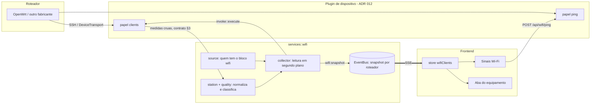

# Monitoramento de Sinais e Clientes Wi-Fi

> **Status:** 🟢 Fases 1–4, aparelhos vigiados com alertas e **Mapa Wi-Fi em tempo real** (distância
> aproximada, roaming e ping-pong) concluídos (OpenWrt). Fase 5 (outros fabricantes) aberta — ver §9.
> **Backend:** `backend/crates/network-wifi/` · **Frontend:** `frontend/src/components/wifi/`,
> `frontend/src/utils/wifiMap/`, `frontend/src/pages/WifiClientsPage.vue` · **Tempo real:** só SSE
> (`wifi:snapshot`, `wifi:watched`, `wifi:roamed`).

---

## 1. O que resolve

Mostra **quem está conectado** em cada roteador e **como está a conexão** de cada aparelho —
sinal, ruído, retransmissão, velocidade e latência —, para achar sem esforço o cliente longe
demais, a rede com interferência e o aparelho que só parece ruim porque está dormindo.

| Onde | O que o operador faz |
|---|---|
| **Sinais Wi-Fi** (`/wifi`, menu Rede) | Vê os clientes de todos os roteadores juntos, de quem precisa de atenção para quem está bem; filtra em um clique por "Precisam de atenção", "Em repouso", roteador, banda ou busca; vê qual roteador falhou na leitura. |
| **Equipamento** (`/devices/{id}`, aba **Clientes Wi-Fi**) | Os clientes daquele roteador, com os mesmos filtros e o teste de latência. A aba só existe quando o equipamento tem um plugin Wi-Fi ativo. |
| **Aplicativo da frota** (`/apps/{id}`) | Plugins Wi-Fi ganham o atalho **Sinais e clientes** para o painel. |
| **Aparelhos vigiados** (painel do `/wifi`) | Marca câmeras e IoT com **Vigiar**: se sumirem de todos os roteadores por 10 min, ou ficarem com sinal ruim, vira alerta (§5.4). Celular que sai do local nunca alerta, porque nunca é vigiado. |
| **Mapa Wi-Fi** (`/wifi`, aba **Mapa**) | Vê cada AP com os aparelhos em volta, à distância aproximada; a linha vai do verde ao vermelho pela qualidade do enlace; o aparelho que troca de AP desliza de um para o outro; clica num aparelho e abre o painel com as medidas e o histórico de roaming (§5.5, §7.4). |
| **Configurações › Wi-Fi** | Ajusta de quanto em quanto tempo o mapa e a leitura em segundo plano leem os APs, o ambiente da estimativa de distância (padrão e por AP), a retenção do histórico de roaming e o ping-pong. |

Em todas as telas: **Ler agora** pede uma leitura nova; **Medir** mede a latência do roteador
até o cliente. Perfil somente leitura vê tudo, mas não dispara comando no roteador.

---

## 2. Arquitetura



Princípios que não se negociam:

- **Fabricante novo é plugin novo.** Nenhum código da plataforma conhece slug: quem tem o bloco
  `wifi` no manifesto alimenta o painel (§3). O plugin só **lê**; não classifica.
- **A classificação mora num lugar só** (`services::wifi::quality`). Plugin e tela consomem
  faixas e saúde prontas — a tela só escolhe a cor.
- **Nada de número inventado.** Sem ruído, não há SNR; sem contadores, não há retransmissão;
  sem resposta ao ping, não há média. O campo vem `null` e a tela diz o que falta.
- **Tempo real só pelo SSE** (AGENTS §9). Não existe rota de consulta das estações.

---

## 3. Contrato do plugin

### 3.1 Bloco `wifi` no manifesto

```json
"wifi": { "clients": "clients", "ping": "ping" }
```

| Papel | Obrigatório | Ação | Parâmetros |
|---|---|---|---|
| `clients` | sim | leitura (`effect: read`), sem revelar segredo | nenhum |
| `ping` | não | leitura | exatamente `target` (texto: o IP da estação) |

`manifest::validate` recusa papel que cite ação inexistente, ação de escrita, ação que revela
segredo ou parâmetro fora do contrato. O `ping` dispensa teste funcional (precisa de um
cliente conectado como alvo), como o `run` do teste de enlace.

### 3.2 Saída de `clients`

`{ "summary": "...", "clients": [ … ] }`, uma entrada por estação, chaves em `snake_case`,
valor desconhecido como `null`:

| Chave | Tipo | Observação |
|---|---|---|
| `mac` | texto | obrigatório; inválido descarta a estação |
| `signal_dbm` | inteiro | obrigatório; sem ele não há classificação |
| `ip`, `hostname` | texto | do lease DHCP / ARP (`*` vira sem nome) |
| `ssid`, `bssid`, `radio` | texto | da interface onde a estação está |
| `band` | `2g` \| `5g` \| `6g` | outro valor vira `null` |
| `channel`, `channel_width_mhz` | inteiro | |
| `signal_avg_dbm`, `noise_dbm` | inteiro | ruído do rádio — base do SNR |
| `rx_rate_bps`, `tx_rate_bps` | inteiro | taxa física do enlace |
| `mcs` | inteiro | |
| `tx_packets`, `tx_retries` | inteiro | contadores desde a associação |
| `inactive_ms`, `connected_s` | inteiro | |
| `frequency_mhz` | inteiro | frequência do rádio (`5180`) — base da distância (§4.3) |
| `tx_power_dbm` | inteiro | potência configurada no rádio — base da distância (§4.3) |

`frequency_mhz` e `tx_power_dbm` são **opcionais**: plugin antigo, que não os informa, continua
valendo. Sem frequência, a plataforma a deduz do canal (`2407 + 5·canal` em 2,4 GHz, `5000 + 5·canal`
em 5 GHz, `5950 + 5·canal` em 6 GHz) e, sem canal, usa o meio da banda; sem potência, o padrão da
banda (20 dBm em 2,4 GHz, 23 dBm em 5/6 GHz). Nos dois casos a distância sai marcada como **menos
confiável** (`calibrated: false`).

### 3.3 Saída de `ping`

`{ "sent": 3, "received": 2, "avg_ms": 4.5 }` — `avg_ms` é `null` sem resposta. Cliente que
não responde é **perda**, não erro; erro é o roteador não conseguir medir.

---

## 4. Classificação

### 4.1 Faixas (`WifiGrade`)

| Medida | Excelente | Bom | Atenção | Ruim | Crítico |
|---|---|---|---|---|---|
| Sinal (RSSI) | ≥ -60 dBm | -61 a -70 | -71 a -78 | -79 a -84 | ≤ -85 |
| SNR | ≥ 30 dB | 25–29 | 15–24 | 10–14 | < 10 |
| Retransmissão | < 10 % | 10–15 % | 15–25 % | 25–40 % | > 40 % |
| Latência (ping) | < 10 ms | ≤ 25 ms | ≤ 60 ms | ≤ 150 ms | > 150 ms ou perda |

- **SNR** = `signal_dbm − noise_dbm`.
- **Retransmissão** = `tx_retries ÷ (tx_packets + tx_retries) × 100`, uma casa decimal.

### 4.2 Saúde (`WifiHealth`), na ordem em que é decidida

1. **Em repouso** (`power_save`, azul): parada há mais de 10 s **e** sinal ≥ -72 dBm. É
   economia de energia (celular com a tela apagada, IoT), não problema da rede — não conta em
   "Precisam de atenção".
2. **Sinal ruim** (`critical`, vermelho): sinal ou SNR na faixa ruim/crítica.
3. **Interferência** (`high_retries`, vermelho): retransmissão ruim/crítica com sinal bom.
4. **Atenção** (`fair`, amarelo): qualquer medida na faixa de atenção.
5. **Saudável** (`healthy`, verde).

O motivo vem escrito (`healthReason`): "Sinal fraco: -82 dBm", "Atenção: sinal de -74 dBm,
SNR de 20 dB".

### 4.3 Distância aproximada (`distance::estimate`)

O mapa põe cada aparelho à distância que o sinal sugere, sempre como **faixa** ("~3–6 m"). Modelo
de perda de percurso log-distância:

```text
perda medida  = potência do rádio (dBm) − sinal (dBm)          (a média do sinal, quando houver)
PL(1 m)       = 20·log10(f em MHz) − 27,55 + perda extra de referência do ambiente
d (metros)    = 10 ^ ((perda medida − PL(1 m)) / (10 · n))
faixa         = a mesma conta com a perda −σ e +σ, arredondada para fora
                (passo de 1 m abaixo de 10 m, 5 m até 50 m, 10 m acima)
```

| Ambiente | Expoente `n` | Perda extra de referência | Sombreamento `σ` |
|---|---|---|---|
| Aberto (galpão, área externa) | 2,2 | 4 dB | 4 dB |
| Escritório ou casa (padrão) | 3,0 | 7 dB | 6 dB |
| Muitas paredes (alvenaria, lajes) | 3,8 | 10 dB | 8 dB |

O ambiente padrão e o de cada AP ficam nas Configurações de Wi-Fi. Exemplo: 5 GHz (5180 MHz),
23 dBm, sinal -58 dBm, escritório → perda 81 dB, PL(1 m) 53,7 dB, ≈ 8 m, faixa **~5–15 m**. A
distância fica entre 0,5 m e 300 m.

**Limitações** (por isso nunca é um número exato):

- O sinal do `station dump` é o que o **aparelho** envia ao AP. A perda do caminho é a mesma nos
  dois sentidos, mas o aparelho transmite em geral menos que o AP (celular 14–18 dBm); essa
  diferença, mais antenas e o corpo de quem segura o celular, está embutida na perda extra de
  referência de cada ambiente.
- Paredes, portas, móveis e pessoas mudam o sinal em 5–10 dB no mesmo lugar; o `σ` alarga a faixa
  para cobrir isso. Um aparelho atrás de uma parede de concreto aparece mais longe do que está.
- A distância é só do AP até o aparelho: sem planta baixa nem coordenadas, não há direção — o
  ângulo no desenho é só para não sobrepor.
- Sem `tx_power_dbm` (driver que mostra `Tx-Power: unknown`), vale o padrão da banda e o painel
  avisa "menos confiável".

### 4.4 Qualidade do enlace (`quality::link_score`)

A cor da linha AP↔aparelho é uma nota contínua de 0 (vermelho) a 1 (verde), na mesma tabela do §4.1:
cada medida vira nota pelas fronteiras das faixas (excelente 1, bom 0,75, atenção 0,5, ruim 0,25,
crítico 0, interpolando entre elas — sinal até -90 dBm, SNR até 5 dB, retransmissão até 60%) e vale
**a pior**, como na saúde. Em repouso, a retransmissão acumulada não conta. A tela só mistura as
cores do tema (`error` → `warning` → `success`).

---

## 5. Backend

### 5.1 Módulos (`services/wifi/`)

| Módulo | Responsabilidade |
|---|---|
| `source` | O plugin Wi-Fi de cada equipamento (o exclusivo do equipamento vale mais que o de modelo) e a execução de um papel pela mesma porta da tela (`invoke::execute`: auditada, no histórico do plugin). |
| `contract` | Desserializa a saída dos papéis (§3) — fora do contrato é erro com motivo. |
| `station` | MAC normalizado (`neighbor_cache::normalize_mac`), fabricante e MAC privado (`vendors::lookup`), SNR, retransmissão e ordenação da pior para a melhor. |
| `quality` | Faixas, saúde e a nota contínua do enlace (§4). Funções puras. |
| `distance` | A distância aproximada pelo sinal (§4.3). Função pura. |
| `settings` | As Configurações de Wi-Fi (`system_settings`, chave `wifi.settings`): intervalos, ambiente padrão e por AP, retenção e ping-pong, com os limites. |
| `collector` | A leitura dos APs e a publicação no SSE; no fim de toda leitura, entrega a rodada ao `roaming`. |
| `rounds` | Uma rodada da frota (ler todos os APs + procurar os vigiados); uma por vez no processo (`RunGuard`). |
| `live` | O coletor do mapa aberto: só lê com o interesse `wifi` declarado no stream SSE (§5.3). |
| `routines` | A leitura em segundo plano (`vigia_wifi`) e a retenção do histórico de roaming (`roaming_wifi`). |
| `roaming` | Onde cada aparelho está (`detect::locate`), quem trocou de AP (`detect::detect`), o histórico, o evento `wifi:roamed` e o ping-pong (`facts`, dataset `wifi_roaming`). |
| `ping` | Valida o IP, roda o papel `ping` e classifica a latência. |
| `watchlist` | Os aparelhos vigiados (`wifi_watched_clients`): cadastro, estado gravado e a lista no SSE. |
| `watch` | O vigia: em cada rodada da frota, acha cada vigiado em qualquer AP e entrega os fatos ao motor de alertas. |

DTOs em `dtos.rs` (bindings `frontend/src/bindings/Wifi*.ts`). A capacidade
`DeviceCapabilities.wifi` diz se o equipamento tem plugin Wi-Fi — o tipo do cadastro
("access_point") não prova nada. `PluginSummary.wifi` dá o atalho no aplicativo da frota.

### 5.2 API

| Rota | Quem | Resposta |
|---|---|---|
| `POST /api/wifi/refresh` corpo `{ "deviceId"?: n }` | operator, admin | **202** `{ "deviceIds": [...] }` — quem vai ser lido; sem `deviceId`, todos. Equipamento sem plugin Wi-Fi: 400 explicando o que instalar; inexistente: 404. |
| `POST /api/wifi/ping` corpo `{ "deviceId": n, "target": "IP" }` | operator, admin | **200** `WifiPingResult`. IP inválido: 422, antes de tocar o equipamento. |
| `POST /api/wifi/watched` corpo `{ "mac", "name" }` | operator, admin | **201** `WifiWatchedClient`. MAC normalizado; inválido: 422; já vigiado: 409. O primeiro vigiado instala as regras de Wi-Fi. |
| `PATCH /api/wifi/watched/{id}` corpo `{ "name" }` | operator, admin | **200** — renomeia (o nome vai nos alertas). |
| `DELETE /api/wifi/watched/{id}` | operator, admin | **204** — deixa de vigiar e fecha o alerta aberto dele. |
| `GET /api/wifi/roaming?mac=…&limit=…` | todos | **200** `WifiRoamEvent[]` — as trocas de AP do aparelho, da mais recente para a mais antiga (padrão 50, até 200). MAC inválido: 422. É a abertura do painel, sob demanda; as trocas seguintes chegam pelo SSE. |
| `GET /api/wifi/settings` | todos | **200** `WifiSettings`. |
| `PUT /api/wifi/settings` | operator, admin | **200** `WifiSettings` gravado. Fora do limite: 422 com o ajuste. Ambiente por AP igual ao padrão não é guardado. |

### 5.3 Leitura e SSE

- Cada roteador vira um evento `wifi:snapshot` (`WifiDeviceSnapshot`), publicado como
  **snapshot** do barramento (chave `wifi:<id>`): primeiro `reading` (com as estações da
  leitura anterior), depois `ok` ou `failed` (com o erro). Quem conecta depois recebe o último
  estado de cada roteador junto com `stream:connected`.
- Até `plugins::fleet::CONCURRENCY` (4) roteadores lidos ao mesmo tempo; **um roteador por
  pedido de cada vez** — dois cliques ou duas abas não abrem duas sessões SSH no mesmo AP.
- Numa leitura de todos, roteador que perdeu o plugin sai dos snapshots e da tela.
- **Com o mapa aberto:** a aba **Mapa** declara o interesse `wifi` na própria conexão SSE
  (`?interest=wifi`, `useLiveInterest`). Enquanto houver uma conexão assim, **um** laço no servidor
  (`live::spawn`, do initializer) lê a frota a cada `liveIntervalS` (padrão 15 s), descontado o
  tempo da leitura — uma rodada por vez, sem sobrepor. Sem ninguém olhando, o laço só confere o
  interesse a cada 2 s; nunca um ciclo por aba.
- **Sem ninguém olhando:** a rotina `vigia_wifi` lê a frota a cada `backgroundIntervalS` (padrão
  120 s) para manter o histórico de roaming, o ping-pong e o vigia. Com o mapa aberto no mesmo
  processo, ela não lê de novo. Com a área Rede desligada, as duas leituras pausam.
- Cada leitura automática aparece no histórico do plugin com a origem **Mapa Wi-Fi**
  (`Origin::WifiMap`) ou **Vigia de Wi-Fi** (`Origin::WifiWatch`), auditada como a da tela.

### 5.4 Aparelhos vigiados e alertas

**Por que opt-in.** Celular e tablet saem do local o tempo todo; alertar a queda deles seria
ruído. Quem deveria estar sempre conectado (câmera, IoT, impressora) é marcado como **vigiado**
pelo MAC, e só ele gera alerta.

- **Ciclo:** toda rodada da frota (§5.3 — a do mapa aberto ou a da rotina em segundo plano, a cada
  2 min por padrão) procura os vigiados (`watch::observe_fleet`). A leitura é a mesma da tela
  (`collector::read_fleet`): sai pelo SSE e respeita a vez de cada AP.
- **Onde está:** o vigiado é procurado em **todos** os roteadores; roaming é estar conectado, e
  se dois APs o veem, vale o de sinal melhor.
- **Só leitura completa prova ausência.** Se algum roteador falhou ou estava ocupado, quem não
  foi achado fica sem fato naquele ciclo: roteador fora do ar já é alerta do monitor dele, não
  "câmera desconectada".
- **Fatos** (`alerts::datasets::wifi_client`, escopo `wifi_client:<id>`): `wifiClientName`,
  `wifiClientStatus` (`connected`/`offline`), `wifiClientOfflineSeconds` (desde `last_seen_at`
  gravado — sobrevive a restart), `wifiClientSignalDbm` e `wifiClientHealth`.
- **Regras** (catálogo, aplicadas uma vez quando o primeiro aparelho é vigiado,
  `catalog::once::ensure_wifi_watch`):

| Regra | Condição | Severidade |
|---|---|---|
| `wifi_watched_offline` — Aparelho vigiado fora do Wi-Fi | `wifiClientOfflineSeconds ≥ 600` | crítico |
| `wifi_watched_poor_signal` — Aparelho vigiado com sinal ruim | `wifiClientHealth = critical` por 15 min | aviso |

  Tempo, severidade e canais se ajustam na tela de regras, como qualquer outra. A volta do
  aparelho (conectado e sem sinal crítico) põe o alerta em recuperação; deixar de vigiar o
  fecha na hora.
- **Estado na tela:** `pending` (aguardando a primeira leitura completa), `connected` ou
  `offline`, publicado como snapshot `wifi:watched` no boot, a cada ciclo e a cada mudança.

### 5.5 Roaming e ping-pong

- **Onde está cada aparelho** (`roaming::detect::locate`): pelas leituras bem-sucedidas da rodada;
  visto por dois APs, vale o de atividade mais recente (com 10 s de folga — a sobra da associação
  antiga) e, empatados, o de sinal melhor. A tela usa o mesmo critério (`dedupeByMac`).
- **Troca de AP** (`detect::detect`): o aparelho aparece num AP diferente do da rodada anterior.
  Quem não aparece numa rodada continua onde estava (o "Ler agora" de um AP só não apaga os outros);
  quem some por mais de 10 min e volta noutro AP é reconexão, não roaming. A memória de onde cada
  um estava é do processo: depois de um restart, a primeira rodada só reaprende.
- **Histórico** (`wifi_roaming_events`): hora, MAC, AP de origem e destino (id e nome — o nome fica
  se o equipamento for apagado), sinal antes (última leitura no AP antigo) e depois, e se a troca
  fechou o ping-pong. Retenção pelas Configurações de Wi-Fi (padrão 30 dias), na purga periódica
  (`RetentionJob` `roaming_wifi`).
- **Ao vivo:** cada troca sai pelo SSE como `wifi:roamed` (efêmero, fora do feed) — o mapa anima e
  o painel aberto ganha a linha.
- **Ping-pong:** `pingPongCount` trocas em `pingPongWindowMin` minutos (padrão 4 em 10). A contagem e
  a gravação vão na mesma transação (`begin_write`). Os fatos (dataset `wifi_roaming`, escopo
  `wifi_roaming:<mac>`): `wifiRoamStatus` (`ping_pong` | `stable`) e `wifiRoamCount`. A regra de
  catálogo **Aparelho em ping-pong entre APs** (`wifi_roaming_ping_pong`, aviso,
  `wifiRoamStatus = ping_pong`) entra uma vez na vida da instalação, com a primeira troca vista
  (`catalog::once::ensure_wifi_roaming`). Quem esteve em ping-pong é reavaliado a cada rodada até
  estabilizar — o alerta entra em recuperação; depois de um restart, a lista sai do banco (últimas
  24 h). O nome no alerta é o de vigiado, senão o do DHCP.

---

## 6. Plugin OpenWrt (`openwrt-wifi` 2.8.0)

- **`clients`**: uma sessão SSH só. Para cada interface de `iw dev`: `iwinfo <if> info` (SSID,
  BSSID, modo, canal, frequência → banda e `frequency_mhz`, largura, `Tx-Power` → `tx_power_dbm`,
  ruído, PHY) e `iw dev <if> station dump`
  (sinal, sinal médio, taxas, MCS, pacotes, retransmissões, inatividade, tempo conectado);
  depois `/tmp/dhcp.leases` e `/proc/net/arp` para nome e IP. Só entram estações de interfaces
  em modo **Master** — vizinhos do mesh 802.11s e o uplink não são clientes.
- **`ping`**: `ping -c 3 -W 1 -q <alvo>` (busybox ou iputils), com o alvo validado pelo esquema
  e passado por `shell_quote`.
- Testes unitários com fixtures reais: dois APs com mesh, roteador sem rádio, 2,4 GHz com
  `Tx-Power: unknown` (a frequência vem, a potência não), ping com média, cliente mudo e roteador
  sem `ping`. Só comandos de leitura — nada muda no roteador.

---

## 7. Frontend

### 7.1 Peças

| Arquivo | Responsabilidade |
|---|---|
| `stores/wifiClients.ts` | Snapshots por roteador (só do SSE), pedido de leitura e estado do ping por estação. |
| `utils/wifiPresentation.ts` | Cores e rótulos por faixa/saúde/banda, nome da estação, filtros, contagens, achatamento dos snapshots, *guard* do payload. |
| `components/wifi/WifiStationsTable.vue` | Tabela (cards no celular) usada pelas duas telas, sobre `ResponsiveDataTable`. |
| `WifiStationIdentity` · `Network` · `Signal` · `Health` · `Ping` | Uma célula cada — a mesma na tabela e no card. |
| `WifiStationFilters.vue` | Chips de um clique com contagem, banda, roteador e busca. |
| `WifiReadSummary.vue` · `WifiRefreshButton.vue` | Estado da leitura ("lido há 2 min", "lendo agora…", "falhou") e o botão **Ler agora**. |
| `DeviceWifiClients.vue` | A aba do equipamento. |
| `pages/WifiClientsPage.vue` | O painel geral: resumo, roteadores (verde/azul/vermelho, com o erro no tooltip), aparelhos vigiados e tabela. |
| `WifiWatchedPanel.vue` | A lista dos vigiados: estado, onde está ou desde quando sumiu, renomear e deixar de vigiar. |
| `WifiWatchButton.vue` · `composables/useWifiWatch.ts` | O botão **Vigiar**/**Vigiado** na linha, e os diálogos (nome, aviso de MAC privado, confirmação) num lugar só. |
| `WifiMap.vue` | A aba **Mapa**: o canvas, zoom/enquadrar, o chip "Ao vivo", as trocas de AP recentes, o tooltip e o painel; declara o interesse `wifi` (`useLiveInterest`). |
| `composables/wifi/useWifiMap.ts` | O Cytoscape do mapa: aplica por diferença (`syncElements`), anima deslocamento, troca de AP (desliza do AP antigo, com as "formigas" do `antsAnimator`) e saída (esmaece e some), destaca o aparelho e o AP ao passar o mouse. |
| `utils/wifiMap/layout.ts` | O desenho radial, puro: escala logarítmica com teto (60 m), ângulo estável pelo hash do MAC, anéis de 5/10/20/40 m, APs em grade sem sobreposição. |
| `utils/wifiMap/elements.ts` · `style.ts` · `deviceKind.ts` | Os elementos (dados e classes), a folha de estilo pelo tema e a cor contínua da linha, e o ícone pelo nome do DHCP e fabricante. |
| `WifiMapStationPanel.vue` · `WifiRoamingHistory.vue` · `WifiMapLegend.vue` | O painel do aparelho (reaproveita as células `WifiStation*`), o histórico de roaming e a legenda. |
| `stores/wifiSettings.ts` · `components/settings/WifiSettingsCard.vue` | As Configurações de Wi-Fi (aba **Wi-Fi**, área Rede). |

Formatação só por `@/utils/formatters` (`formatBps`, `formatLatency`, `formatPercent`,
`formatRelativeTime`) e `formatOutputValue(…, 'uptime')` para "conectado há".

### 7.2 Experiência

- Cliente sem nome é "Aparelho Apple" (fabricante) ou "Aparelho com MAC privado" — nunca um
  campo em branco.
- O motivo da saúde aparece escrito embaixo do chip, não escondido em tooltip.
- **Medir** fica desabilitado com o porquê: perfil somente leitura, plugin sem `ping` ou
  cliente sem IP conhecido. O resultado mostra média, perda e cor da faixa.
- Painel sem nenhum roteador com plugin Wi-Fi explica o que instalar, em vez de uma tabela vazia.
- Aparelho conectado há mais de um dia com MAC de fábrica ganha o chip **Sempre conectado — vale
  vigiar**: a tela sugere, quem decide é o usuário. Vigiado, a linha mostra o nome dado a ele.
- Vigiar um aparelho de MAC privado avisa que o MAC pode mudar e o alerta disparar à toa.

### 7.3 Tempo real sem polling

As estações chegam só pelo SSE. Ao abrir o painel ou a aba **sem nenhum snapshot guardado**
(servidor recém-iniciado), a tela pede **uma** leitura — ação pontual, não ciclo. Não há
`setInterval`, `refetch` nem consulta repetida. `tests/stores/wifiEvents.spec.ts` prova que o
snapshot atualiza a store **e o mapa** sem nenhuma chamada HTTP, e que a troca de AP chega pelo SSE.

### 7.4 Mapa Wi-Fi

- **Desenho:** cada AP é um centro (grade de células, sem sobreposição); os aparelhos ficam em volta
  à distância estimada, em escala logarítmica com teto (quem está a 80 m fica na borda, não some).
  Anéis tracejados marcam 5, 10, 20 e 40 m. Muitos aparelhos num AP se afastam o mínimo e alternam
  de anel, sem virar borrão.
- **Linha:** a cor é a nota do enlace (§4.4); a espessura, a taxa física; pontilhada em repouso.
  A cor nunca é o único sinal: borda grossa = precisa de atenção, anel azul = vigiado, rótulo com
  o nome e o sinal, tooltip com AP, rede, sinal, SNR, distância e saúde.
- **Nó:** ícone pelo tipo provável (nome do DHCP, depois fabricante; na dúvida, genérico); nome curto
  (vigiado → DHCP → fim do MAC).
- **Movimento:** atualização por diferença; quem troca de AP desliza do AP antigo ao novo com
  destaque e a linha andando; quem sai do Wi-Fi esmaece e some; AP com leitura falhando fica com
  borda vermelha tracejada e "leitura falhou" no rótulo.
- **Filtros:** os mesmos da lista e compartilhados entre as abas (estado, SSID, banda, AP, só
  vigiados, busca por nome/MAC/IP/nome do vigiado).
- **Painel:** MAC, IP, fabricante, SSID, banda/canal, sinal, ruído, SNR, taxas, retransmissões,
  distância (faixa), conectado há, saúde, potência e frequência do rádio, **Medir**, **Vigiar** e o
  histórico de roaming.
- **Chat:** com a aba Mapa aberta, o `useAiScreenDetail` diz "aba Mapa" e o aparelho selecionado
  (nome, AP, sinal, distância e saúde).

---

## 8. Como adicionar um fabricante

1. No plugin do fabricante, escreva a ação de leitura que devolve o contrato do §3.2 e, se o
   equipamento souber, a de ping do §3.3.
2. Declare `"wifi": { "clients": "<ação>", "ping": "<ação>" }` no manifesto.
3. Testes unitários com a saída real do equipamento (o `cargo test` exige teste de toda ação).

Nada muda no backend nem no frontend. Referências de leitura:

- **MikroTik RouterOS**: `/interface wireless registration-table print detail` (ou
  `/interface wifi registration-table` no RouterOS 7, `/caps-man registration-table` com
  CAPsMAN) e `/ip dhcp-server lease print detail`.
- **Grandstream GWN**: lista de clientes da API local do AP.

---

## 9. Roadmap

- [x] **Fase 1 — Contrato e plugin OpenWrt** 🟢 Concluído — bloco `wifi` validado no manifesto,
  papéis `clients` e `ping` no `openwrt-wifi` com fixtures reais.
- [x] **Fase 2 — Serviço e API** 🟢 Concluído — `services::wifi`, `POST /api/wifi/refresh` (202 +
  SSE) e `POST /api/wifi/ping`, capacidade `wifi` do equipamento, testes de requisição de ponta a
  ponta com um AP local.
- [x] **Fase 3 — Aba do equipamento** 🟢 Concluído.
- [x] **Fase 4 — Painel Sinais Wi-Fi** 🟢 Concluído — rota `/wifi`, menu, atalho no aplicativo.
- [ ] **Fase 5 — Outros fabricantes**: MikroTik (`mikrotik-routeros` ganha o bloco `wifi`) e
  Grandstream GWN.
- [ ] **Cliente preso (*sticky*)**: exige saber que outro AP o ouve melhor (relatórios 802.11k
  ou leitura cruzada dos APs).
- [x] **Aparelhos vigiados e alertas** 🟢 Concluído — opt-in por MAC, vigia a cada 5 min, regras
  de "fora do Wi-Fi" e "sinal ruim" no motor de alertas (§5.4).
- [x] **Mapa Wi-Fi em tempo real** 🟢 Concluído — aba **Mapa** no `/wifi`: APs com os aparelhos em
  volta, distância aproximada (log-distância calibrada com a potência e a frequência do rádio,
  ambiente por AP), linha do verde ao vermelho pela qualidade combinada, animação de roaming,
  histórico de trocas (30 dias), alerta de ping-pong e coletor ao vivo só com o mapa aberto
  (`openwrt-wifi` 2.8.0 informa potência e frequência).
- [ ] **Validação do mapa com os APs OpenWrt reais** (só leitura): conferir `Tx-Power` e frequência
  no `iwinfo` de produção, a faixa de distância contra a distância real de alguns aparelhos e um
  roaming de verdade entre os dois APs.
- [ ] **Histórico por estação**: gravar amostras para ver a evolução do sinal de um aparelho.

---

## 10. Validação

```bash
# Backend (de backend/)
cargo fmt --all --check
cargo clippy --all-targets -- -D warnings
cargo test
cargo build --release

# Frontend
pnpm --prefix frontend run typecheck
pnpm --prefix frontend run lint
pnpm --prefix frontend run format:check
pnpm --prefix frontend run test
pnpm --prefix frontend run build
```
