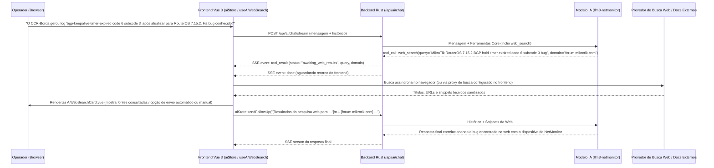

# Pesquisa Web Assistida pelo Frontend para a IA (`web_search`)

Este documento especifica a arquitetura e a implementação da ferramenta **`web_search`** no assistente de IA do NetMonitor (`/api/ai/chat`), projetada para buscar informações externas na web (novos erros de syslog, CVEs, bugs de firmware RouterOS/OpenWrt/Huawei/Cisco, códigos de falha de ONUs/OLTs ou documentação recente de containers Docker) **diretamente a partir do navegador do usuário (frontend)** e enviá-las de volta para a IA.

---

## 1. Motivação e Caso de Uso

O NetMonitor opera frequentemente em redes corporativas, provedores (ISPs) ou ambientes isolados onde:
1. O container do **backend** (`netmonitor-backend`) ou do **Ollama** fica em uma VLAN de gerência restrita sem saída direta para a internet pública (ou atrás de firewall corporativo estrito), enquanto a estação de trabalho do operador (onde o **frontend** Vue 3 roda no navegador) possui acesso à internet;
2. Mesmo quando há saída para a web, é desejável que o operador visualize, audite ou autorize qual termo está sendo consultado externamente antes que dados saiam do ambiente de monitoramento;
3. Erros inéditos de firmware (ex.: `RouterOS v7.15 bgp-session-flap`, `Huawei MA5800 alarm 0x2e10a005`, `Docker containerd shim CVE-2024-21626`, `OpenWrt mt76mcu timeout`) não constam na base estática interna (`search_system_docs`), exigindo consulta a fontes externas (`forum.mikrotik.com`, `nvd.nist.gov`, `docs.docker.com`, etc.).

Para resolver isso mantendo o princípio de segurança do NetMonitor, a ferramenta `web_search` segue o padrão **`ToolKind::Interactive`** (mesmo fluxo arquitetural do `ask_user` / `AiQuestionCard.vue`): o backend emite o pedido de busca via SSE, o **frontend** realiza a busca externa (ou exibe o card de confirmação/resultados) e devolve os trechos encontrados para a IA concluir o diagnóstico.

---

## 2. Arquitetura do Fluxo (Frontend -> IA)



---

## 3. Contrato da Ferramenta (`web_search`)

A ferramenta faz parte do grupo **`core`** em `backend/contracts/ai_chat.json` e `backend/src/services/ai/harness/tools/inventory.rs`, estando disponível desde a primeira rodada sem exigir `load_tools`:

```json
{
  "name": "web_search",
  "description": "Pesquisa na web erros, CVEs, bugs de firmware, códigos de falha de fabricantes ou documentação externa recente que não constam na base interna. No chat, o navegador busca e envia os trechos encontrados para a IA.",
  "parameters": {
    "type": "object",
    "properties": {
      "query": {
        "type": "string",
        "description": "Termo técnico, mensagem de erro, CVE, modelo/firmware ou protocolo a pesquisar na web"
      },
      "domain": {
        "type": "string",
        "description": "Domínio ou fonte opcional para priorizar (ex: forum.mikrotik.com, nvd.nist.gov, docs.docker.com)"
      }
    },
    "required": ["query"]
  }
}
```

### Quando a IA deve usar `search_system_docs` vs `web_search`

| Situação | Ferramenta Correta | Motivo |
|---|---|---|
| Dúvida sobre funcionalidades, arquitetura, portas, backups, plugins ou runbook do próprio NetMonitor | `search_system_docs` | A documentação oficial do NetMonitor está embutida localmente em `SYSTEM_DOCS`. |
| Investigação de vulnerabilidade pública (CVE), bug de versão específica de firmware (RouterOS, OpenWrt, VRP Huawei, IOS-XE), código de erro de fabricante ou falha externa inédita | `web_search` | Informações de terceiros e advisories recentes estão na web externa e são buscados pelo frontend. |
| Diagnóstico de erro nos logs internos do dispositivo + busca da causa raiz no fabricante | `grep` / `get_device_detail` -> `web_search` | Primeiro coleta o erro real no NetMonitor e em seguida pesquisa o código exato na web. |

---

## 4. Retorno do Backend (`ToolOutput`)

Quando o modelo emite `web_search`, a implementação em `backend/src/services/ai/harness/tools/inventory.rs` valida os parâmetros (`query` obrigatório e `domain` opcional), sanitiza o texto e retorna um payload estruturado com `status: "awaiting_web_results"`:

```json
{
  "status": "awaiting_web_results",
  "query": "MikroTik RouterOS 7.15.2 BGP hold timer code 6 subcode 3",
  "domain": "forum.mikrotik.com",
  "search_url": "https://duckduckgo.com/?q=site%3Aforum.mikrotik.com+MikroTik+RouterOS+7.15.2+BGP+hold+timer+code+6+subcode+3",
  "hint": "O navegador executa a busca externa e envia os trechos relevantes na próxima mensagem da conversa."
}
```

Assim como em `ask_user` (`ToolKind::Interactive`), o loop de ferramentas (`harness/runner.rs`) encerra o turno atual imediatamente após emitir o evento SSE `tool_result`, devolvendo o controle para o frontend sem gastar chamadas extras ao LLM antes que os resultados da web cheguem.

---

## 5. Implementação no Frontend (`frontend/src/`)

### 5.1. Metadados do Card (`frontend/src/components/ai/aiToolMeta.ts`)

No mapa `TOOL_META`, `web_search` é registrado com ícone e rótulo amigáveis:

```ts
web_search: { label: 'Pesquisa na Web', icon: 'pi-globe' },
```

### 5.2. Composable de Busca no Navegador (`frontend/src/composables/useAiWebSearch.ts`)

O frontend executa a pesquisa a partir do navegador do operador utilizando provedores configuráveis:
1. **Modo Automático (API/Proxy de Busca no Browser)**:
   - Consulta endpoint JSON configurável nas preferências do chat (ex.: SearXNG local/corporativo, DuckDuckGo Instant Answer API, Brave/Tavily/Google Custom Search configurado no browser) diretamente via `fetch` do navegador;
   - Sanitiza o HTML, remove scripts/trackers, trunca cada snippet em no máximo `400` caracteres (máximo de `5` resultados, ~`2.000` caracteres no total) para caber com folga na janela de contexto do modelo local (`4096` tokens).
2. **Modo Assistido / Semi-Automático (Fallback Zero-Config)**:
   - Caso o navegador bloqueie CORS ou nenhum provedor automático esteja configurado, o card `AiWebSearchCard.vue` exibe um botão **"Abrir busca em nova aba"** (`search_url`) e uma caixa de colagem rápida (**"Colar trecho encontrado e enviar para a IA"**), permitindo que o operador cole o trecho da documentação/fórum em 1 clique.

### 5.3. Componente `AiWebSearchCard.vue` e Integração com `aiStore.sendFollowUp`

Em `AiChatMessage.vue`, quando um `toolCall` concluído possui `tc.name === 'web_search'` e `tc.result?.status === 'awaiting_web_results'`, o componente renderiza `<AiWebSearchCard>`:

```ts
// Formato da mensagem enviada pelo frontend de volta para a IA via aiStore.sendFollowUp():
const formattedPayload = [
  `[Resultados da pesquisa web para "${query}"${domain ? ` (fonte: ${domain})` : ''}]`,
  ...results.map((r, idx) => `${idx + 1}. [${r.title}](${r.url}): ${r.snippet}`),
  `Analise os resultados acima em conjunto com os dados do NetMonitor e responda de forma objetiva.`
].join('\n')

await aiStore.sendFollowUp(formattedPayload)
```

---

## 6. Segurança e Privacidade (Guardrails)

1. **Prevenção de Vazamento de Credenciais (DLP no Frontend e Backend)**:
   - Antes de disparar ou exibir a busca, um filtro regex remove automaticamente senhas, tokens Bearer, chaves privadas SSH/WireGuard e strings de comunidade SNMP caso o modelo tente incluí-los acidentalmente em `query`.
2. **Sanitização contra Prompt Injection Indireto**:
   - Os trechos retornados da web são convertidos para texto puro (strip de tags HTML, caracteres de controle e sequências `<|...|>` ou `[TOOL_CALLS]`) antes de serem enviados em `aiStore.sendFollowUp`, impedindo que uma página externa injete instruções maliciosas no modelo local.
3. **Controle de Domínio (`domain`)**:
   - O parâmetro opcional `domain` prioriza fontes técnicas confiáveis (`forum.mikrotik.com`, `nvd.nist.gov`, `cve.mitre.org`, `docs.docker.com`, `openwrt.org`, `support.huawei.com`, `postgresql.org`).

